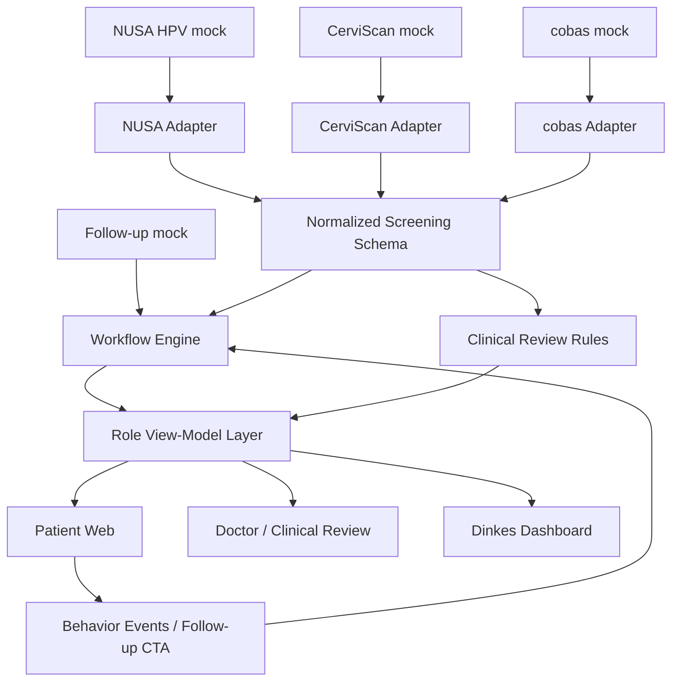
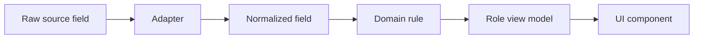

# GenoHack 2026 - Prototype & Mock Data Integration Plan

**Project:** Kelompok B - Track 1: Precision Diagnostics Based on Genomics  
**Technology owners:** Jonathan Harefa + Rici  
**Document purpose:** technical/product handoff untuk mengubah prototype web yang saat ini masih banyak memakai asumsi UI menjadi prototype yang **data-driven**, konsisten dengan mock data tim, dan tetap mengikuti keputusan role/dashboard dari Kak Ara.  
**Baseline date:** keputusan dan file sampai **20 Oktober 2026 malam**.  
**Primary implementation target:** repository website yang sudah dibuat Rici; tidak perlu repository baru untuk data/model pada fase hackathon.

---

## 0. Executive decision

Prototype final untuk hackathon harus dipahami sebagai **satu web application dengan satu data/domain layer**, tetapi menghasilkan pengalaman yang berbeda menurut role.

Tiga primary experience yang dipertahankan dari arahan Kak Ara:

1. **Patient** - hasil tes dalam bahasa manusia, next step, progress tindak lanjut, dan engagement untuk mendorong screening/follow-up.
2. **Doctor / clinical reviewer** - hanya melihat detail teknis yang diperlukan untuk kasus yang memang perlu human review; bukan duplicate patient dashboard dan bukan tempat semua pasien harus divalidasi manual.
3. **Government / Dinkes** - insight agregat program, follow-up funnel, data quality, dan bottleneck; tidak menampilkan identitas individual secara default.

Prototype **bukan UI yang ditaruh pada layar alat NUSA**. Bentuk alat fisik, termasuk gambar alat besar dengan touchscreen yang sempat dibahas pada 18 Oktober, **bukan acuan UI software**. Acuan software adalah:

```text
output data alat / screening source
        +
follow-up data
        +
product rules
        -> normalized data
        -> role-specific view
```

Arah data MVP:

```text
NUSA mock raw -----------\
                         \
CerviScan mock raw --------> source adapters -> normalized screening result
                         /                         |
cobas mock raw ----------/                          +-> workflow / follow-up state
                                                   +-> clinical review state
                                                   +-> role-specific view models
                                                            |
                                      +---------------------+----------------------+
                                      |                     |                      |
                                  Patient               Doctor                 Dinkes
```

**Clinical ML prediction bukan dependency MVP.** Data sekarang sintetis sehingga valid untuk menguji integrasi, adapter, rule engine, dashboard, dan demo flow; data tersebut **tidak valid untuk membuktikan model prediksi klinis pada pasien nyata**.

---

# 1. Decision register: keputusan mana yang masih berlaku dan mana yang harus dibuang

Bagian ini sengaja dibuat berdasarkan urutan waktu karena percakapan tim berubah sangat cepat.

| Waktu / sumber | Keputusan / ide saat itu | Status sekarang | Implementasi |
|---|---|---|---|
| 18 Okt sekitar 15:40, grup | Gambar konsep alat portable/besar memiliki touchscreen dan contoh hasil di alat | **DEPRECATED sebagai acuan software UI** | Jangan membuat web app meniru screen alat. Jika reader kelak punya layar, layar tersebut hanya device-operation UI, bukan dashboard utama. |
| 18 Okt 16:26, grup | Sambil menunggu data, Rici/Jonathan boleh membuat mock UI/UX dahulu | **KEEP hanya sebagai visual skeleton** | Layout/component yang bagus boleh dipakai; seluruh clinical numbers/content yang dibuat berdasarkan asumsi harus diganti data nyata dari mock workbook. |
| 18 Okt 17:03, chat Jonathan-Ara | Yang penting untuk software adalah output data alat, bukan bentuk alat | **LOCKED** | Data contract menjadi source of truth UI. |
| 18 Okt 17:03, chat Jonathan-Ara | Software sebaiknya web app agar pasien tidak wajib download aplikasi | **LOCKED** | Pertahankan web-first/responsive design. |
| 18 Okt 17:16, chat Jonathan-Ara | Tiga view: pasien, dokter, pemerintah/Dinkes | **LOCKED sebagai role principle** | Tiga role utama tetap ada, tetapi isi masing-masing harus disesuaikan data/latest workflow. |
| 18 Okt 17:16, chat Jonathan-Ara | Dokter memvalidasi data yang diragukan mesin/risk profiling | **KEEP tetapi dipersempit** | Jangan membuat dokter memvalidasi semua hasil. Doctor queue hanya untuk case yang memenuhi review trigger yang jelas. |
| 18 Okt 17:21, grup | Flow ide: raw data -> rekam medis -> bila mesin ragu dokter -> humanized result/PDF pasien | **PARTIALLY SUPERSEDED** | Normalisasi dan human narrative tetap. “Rekam medis” bukan intermediate UI wajib karena workbook terbaru sudah memberi normalized result + follow-up. PDF download optional, bukan core flow. |
| 18 Okt 17:27, chat Jonathan-Ara | Patient data protection harus jadi prinsip architecture | **LOCKED** | Privacy-by-design, RBAC, pseudonymous ID, server-side data access, audit log. |
| 19 Okt 22:04, grup | Workbook `KelompokB_MockData_Software_NUSA_CerviScan_cobas.xlsx` dikirim | **CURRENT DATA BASELINE** | Seluruh clinical/mock display harus traceable ke workbook ini atau derived rule yang terdokumentasi. |
| 19 Okt 22:24, grup | USP software disebut rekomendasi melalui ML | **REVISED / DEFERRED** | ML boleh muncul sebagai roadmap, bukan sebagai validated clinical model sekarang. |
| 20 Okt 00:18-00:21, grup | Tim software diminta mulai menjalankan clickable prototype memakai mock data tersebut | **LOCKED** | Ini tugas utama sekarang. |
| 20 Okt 09:03, grup | Dokumen IVA/Pap smear ditambahkan sebagai calon input | **REFERENCE ONLY untuk MVP** | Tidak perlu melatih image classifier. |
| 20 Okt 17:44, grup | Untuk prototype, klasifikasi citra dapat diasumsikan sudah ada dari medical record | **LOCKED untuk hackathon** | Jangan bangun CNN IVA/Pap smear sekarang. |
| 20 Okt 19:47, grup + model bisnis v4 | NUSA berubah dari alat sekali pakai ke **reusable reader + disposable cartridge** | **LATEST HARDWARE DIRECTION** | Software jangan bergantung pada old device geometry/UI. |
| 20 Okt 20:57, grup | Patient funnel dibalik dari **alat -> software** menjadi **software -> alat/test**; patient UI boleh punya period/breathing/wellness features | **LATEST PATIENT PRODUCT DIRECTION** | Patient landing/home berfungsi juga sebagai acquisition/engagement layer. Clinical result tetap module terpisah dan data-driven. |
| 20 Okt 21:52, grup | Sebelum Jumat: plan arsitektur teknologi + clickable prototype dengan mock data | **CURRENT DELIVERY TARGET** | Architecture + integrated prototype adalah P0. |

### Kesimpulan keputusan

Tiga hal yang paling sering berpotensi salah kalau hanya membaca chat lama:

1. **Jangan menaruh software di layar alat.**
2. **Jangan memaksakan ML prediction karena pernah disebut pada 18-19 Oktober.**
3. **Patient experience terbaru tidak dimulai setelah punya alat; software boleh menjadi entry point sebelum screening.**

---

# 2. Hierarki source of truth

Jika ada konflik antara UI sekarang, chat lama, dan file terbaru, gunakan hierarki berikut.

## Level 1 - Keputusan eksplisit terbaru

Prioritas paling tinggi:

- chat grup terbaru 20 Oktober;
- chat langsung Jonathan dengan Kak Ara untuk aturan role yang tidak tercantum lengkap di grup;
- keputusan yang sudah dikonfirmasi sebagai prototype deliverable.

## Level 2 - Data contract

File utama:

`KelompokB_MockData_Software_NUSA_CerviScan_cobas.xlsx`

Untuk segala hal seperti:

- nama field;
- nullability;
- kategori hasil;
- count dashboard;
- nilai Ct mock;
- follow-up dates;
- source-device differences.

**Workbook menang atas hardcoded UI Rici.**

## Level 3 - Interpretasi data

`KelompokB_Data_Software_NUSA_vs_CerviScan_cobas.pdf`

Dipakai untuk memahami:

- alasan tiga adapter;
- perbedaan availability data;
- positioning software terhadap CerviScan/cobas/NUSA;
- tujuan follow-up loop.

## Level 4 - Product/business direction

`KelompokB_Track1_Model_Bisnis_v4_GenoHack2026-1.pdf`

Dipakai untuk:

- Bio Farma-first positioning;
- software sebagai core business;
- NUSA sebagai growth option;
- patient acquisition / operational value;
- Dinkes/Puskesmas/Kader workflow.

Business document tidak boleh digunakan untuk mengarang field yang tidak ada di data.

## Level 5 - Existing Figma/repo

Figma/web Rici adalah **presentation layer**, bukan source of truth clinical content.

Rule praktis:

> kalau sebuah angka, label diagnosis, risk percentage, tanggal, genotype, status pasien, atau chart tidak bisa dijelaskan “datanya berasal dari field mana?”, elemen tersebut belum boleh dianggap final.

---

# 3. Scope produk yang harus dianggap final untuk prototype

## 3.1 Software adalah produk yang dapat dibuktikan sekarang

Software harus membuktikan empat kemampuan:

1. menerima/merepresentasikan data dari beberapa source;
2. menyeragamkan data yang bentuknya berbeda;
3. mengubah standardized result menjadi workflow yang actionable;
4. menyajikan informasi berbeda sesuai kebutuhan role.

## 3.2 NUSA bukan dependency software

Prototype software harus tetap berjalan walaupun NUSA gagal dikembangkan.

Maka:

```text
CerviScan only -> software tetap berguna
cobas only -> software tetap berguna
NUSA unavailable -> software tetap berguna
```

NUSA menambah richness data, tetapi software tidak boleh memiliki hard dependency terhadap NUSA-only fields.

## 3.3 Current MVP bukan cancer diagnostic model

Output MVP **bukan**:

```text
Cancer probability = 86%
CIN2+ prediction = 74%
You have cervical cancer
AI accuracy = 95%
```

Output MVP yang valid:

```text
Result validity
Program category
HPV target category
Follow-up required / not required
Follow-up progress
Operational priority
Recommended next step
Recall date
Manual review required / not required
```

---

# 4. Data inventory: apa yang benar-benar dimiliki sekarang

Workbook memiliki 8 sheet.

| Sheet | Fungsi | Implementation meaning |
|---|---|---|
| `Baca Dulu` | asumsi dan disclaimer | config + documentation |
| `1 Kamus Data` | definisi 35 variabel | schema reference |
| `2 Mock NUSA` | 60 mock sample NUSA, 28 kolom | raw adapter input |
| `3 Mock CerviScan` | 60 sample, format long qPCR, 5 target per sample | raw adapter input yang perlu group/pivot |
| `4 Mock cobas` | 60 sample, categorical result | raw adapter input |
| `5 Format Standar` | 180 normalized records, 16 kolom | canonical integration output |
| `6 Tindak Lanjut` | 180 workflow records, 13 kolom | follow-up/workflow source |
| `7 Ringkasan` | KPI mock per alat | regression target untuk dashboard |

### Fundamental disclaimer

Seluruh data adalah **synthetic/mock**.

Workbook sendiri menyatakan:

- ID/tanggal/Ct dibuat untuk demo;
- positive composition sengaja sekitar **20%** agar flow terlihat;
- itu bukan prevalence nyata;
- NUSA masih konseptual dan belum tervalidasi;
- metilasi adalah research-only;
- cobas Ct belum terkonfirmasi.

Maka analytics UI perlu label seperti:

> **Synthetic demo dataset - values are for prototype demonstration, not population prevalence or clinical performance.**

---

# 5. Exact raw data structure

## 5.1 NUSA HPV - 60 sample, 28 fields

Raw structure sekarang:

```text
id_perempuan
barcode_A
barcode_B
usia
riwayat_skrining
vaksin_hpv
gejala_merah
cara_ambil
waktu_swab
waktu_mulai_run
langkah_lengkap
id_alat
lot_cartridge
durasi_run_menit
ct_hpv16
ct_hpv18
ct_hpv52
ct_pool_lain
ct_kontrol_internal
status_qc
kategori
status_cabang_B
tgl_kirim_B
tgl_terima_B
dalam_jendela
genotipe_lab
metilasi
kesesuaian_A_B
```

NUSA paling kaya dari sisi data karena mempunyai:

- patient/questionnaire context;
- pre-analytic data;
- Ct;
- internal control;
- device/lot;
- branch B validation/research metadata.

**Tidak semua field NUSA boleh ditampilkan ke pasien.** Banyak field hanya untuk QC/doctor/research.

### NUSA research-only / non-primary fields

```text
metilasi
branch B genotype details
A/B concordance
amplification curve
```

Tidak boleh digunakan untuk membuat clinical claim pada patient UI sekarang.

---

## 5.2 CerviScan - 60 sample, raw long format

Raw columns:

```text
Well
Sample
Target
Kanal (contoh)
Cq
id_perempuan
lab
tgl_run
```

Satu sample muncul beberapa row karena target dipisah:

```text
HPV16
HPV18
HPV52
HR lain (11 tipe)
Beta-globin (IC)
```

Contoh raw pattern:

```text
A01 | CS-26-3400 | HPV16            | ... | N/A  | P-0061
A01 | CS-26-3400 | HPV18            | ... | N/A  | P-0061
A01 | CS-26-3400 | HPV52            | ... | N/A  | P-0061
A01 | CS-26-3400 | HR lain (11 tipe)| ... | N/A  | P-0061
A01 | CS-26-3400 | Beta-globin (IC) | ... | 24.9 | P-0061
```

Maka adapter harus group by `Sample`, lalu pivot target menjadi satu normalized result.

**`N/A` = null**, bukan zero.

---

## 5.3 cobas - 60 sample, categorical-first format

Raw columns:

```text
Sample ID
id_perempuan
HPV16
HPV18
Other HR (12 tipe)
Validity
Ct (semua kanal)
lab
tgl_run
```

Values utamanya:

```text
POS
NEG
Invalid
```

Current workbook secara eksplisit memberi:

```text
Ct = "Perlu cek"
```

Maka UI/API harus menganggap cobas Ct **unavailable / unknown**, bukan membuat angka sendiri.

---

# 6. Canonical normalized schema

Sheet `5 Format Standar` adalah kontrak minimum yang harus direproduksi aplikasi.

Current 16 fields:

```text
sumber_alat
id_sampel
id_perempuan
ct_hpv16
ct_hpv18
ct_hpv52
ct_pool_lain
ct_kontrol_internal
hasil_16
hasil_18
hasil_lain
valid
kategori_kemenkes
delta_ct
tgl_hasil
kelengkapan_data
```

Recommended TypeScript representation:

```ts
export type SourceDevice = "NUSA HPV" | "CerviScan" | "cobas";

export type ProgramCategory =
  | "NEGATIVE"
  | "POSITIVE_16_18"
  | "POSITIVE_OTHER"
  | "INVALID";

export type QualitativeResult = "POSITIVE" | "NEGATIVE" | "INVALID";

export interface NormalizedScreeningResult {
  sourceDevice: SourceDevice;
  sampleId: string;
  patientId: string;

  ct: {
    hpv16: number | null;
    hpv18: number | null;
    hpv52: number | null;
    otherHighRisk: number | null;
    internalControl: number | null;
  };

  qualitative: {
    hpv16: QualitativeResult;
    hpv18: QualitativeResult;
    otherHighRisk: QualitativeResult;
  };

  valid: boolean;
  programCategory: ProgramCategory;
  deltaCt: number | null;
  resultDate: string;
  dataCompleteness: string;
}
```

### Important implementation rule

`null`, `0`, `NEG`, dan `not available` adalah empat hal berbeda.

Frontend tidak boleh melakukan:

```ts
value || 0
```

untuk Ct karena missing Ct akan berubah menjadi angka palsu 0.

Gunakan:

```ts
value == null ? "Not available" : value.toFixed(1)
```

---

# 7. Adapter specification

## 7.1 NUSA adapter

Mapping minimum:

```text
barcode_A            -> sampleId
id_perempuan         -> patientId
ct_hpv16             -> ct.hpv16
ct_hpv18             -> ct.hpv18
ct_hpv52             -> ct.hpv52
ct_pool_lain         -> ct.otherHighRisk
ct_kontrol_internal  -> ct.internalControl
status_qc            -> valid
kategori             -> programCategory
waktu/result date    -> resultDate
```

Store secondary metadata separately:

```text
barcode_B
status_cabang_B
tgl_kirim_B
tgl_terima_B
genotipe_lab
kesesuaian_A_B
metilasi
```

Metilasi harus diberi flag:

```ts
clinicalUse: false
researchOnly: true
```

## 7.2 CerviScan adapter

Pseudo-code:

```ts
const groups = groupBy(rawRows, row => row.Sample);

for (const sample of groups) {
  const targets = indexBy(sample.rows, row => row.Target);

  return {
    sourceDevice: "CerviScan",
    sampleId: sample.id,
    patientId: sample.rows[0].id_perempuan,
    ct: {
      hpv16: parseNullableCq(targets["HPV16"]),
      hpv18: parseNullableCq(targets["HPV18"]),
      hpv52: parseNullableCq(targets["HPV52"]),
      otherHighRisk: parseNullableCq(targets["HR lain (11 tipe)"]),
      internalControl: parseNullableCq(targets["Beta-globin (IC)"])
    }
  };
}
```

Parser:

```text
"N/A" -> null
empty -> null
numeric text -> number
```

## 7.3 cobas adapter

Mapping:

```text
Sample ID          -> sampleId
id_perempuan       -> patientId
HPV16              -> qualitative.hpv16
HPV18              -> qualitative.hpv18
Other HR           -> qualitative.otherHighRisk
Validity           -> valid
Ct                 -> null while unconfirmed
tgl_run            -> resultDate
lab                -> lab metadata
```

Do not calculate `deltaCt` when Ct is unavailable.

---

# 8. Rules and assumptions: what may be computed

Workbook `Baca Dulu` currently uses these assumptions:

| Rule | Value | Status |
|---|---:|---|
| HPV positive Ct threshold | `< 40` | workbook/reference assumption for current mock |
| Internal-control max Ct | `<= 35` | **demo assumption**, not universal medical truth |
| Branch B shipping window | `7 days` | demo assumption |
| IVA target after positive | `60 days` | design KPI for prototype |
| Negative recall | `10 years` | workbook program rule |
| Other HR + normal IVA recall | `3 years` | workbook program rule |
| 16/18 + normal IVA recall | `1 year` | workbook program rule |

Do not scatter these numbers through JSX.

Use config:

```ts
export const DEMO_RULES = {
  hpvCtPositiveThreshold: 40,
  internalControlMaxCt: 35,
  branchBShippingWindowDays: 7,
  contactTargetDays: 2,
  ivaTargetDays: 60,
  recallYears: {
    negative: 10,
    positiveOtherWithNormalIva: 3,
    positive1618WithNormalIva: 1,
  },
};
```

Each rule should carry provenance:

```ts
{
  value: 35,
  source: "Mock workbook assumption",
  clinicalValidated: false
}
```

---

# 9. Program category engine

For current demo:

```text
if result invalid
    -> INVALID
else if HPV16 positive OR HPV18 positive
    -> POSITIVE_16_18
else if HPV52 / other HR positive
    -> POSITIVE_OTHER
else
    -> NEGATIVE
```

Patient-facing text must never convert this into a cancer diagnosis.

Correct:

> HPV risiko tinggi tipe 16/18 terdeteksi. Hasil HPV positif bukan diagnosis kanker dan memerlukan tindak lanjut sesuai alur pemeriksaan.

Incorrect:

> Anda positif kanker serviks.

---

# 10. Follow-up/workflow model

Sheet `6 Tindak Lanjut` provides:

```text
id_perempuan
sumber_alat
kategori
tgl_hasil
tgl_dihubungi_kader
hari_ke_kontak
tgl_iva
hari_ke_iva
iva_dalam_target
hasil_iva
tindakan
histologi
tgl_recall
```

Do not show the spreadsheet's `iva_dalam_target = Tidak` directly because it conflates:

- not yet completed;
- completed late;
- currently still inside target window.

Create explicit domain states:

```ts
export type FollowUpStatus =
  | "ROUTINE_RECALL"
  | "RETEST_REQUIRED"
  | "AWAITING_CONTACT"
  | "AWAITING_IVA"
  | "IVA_SCHEDULED"
  | "IVA_COMPLETED_WITHIN_TARGET"
  | "IVA_COMPLETED_LATE"
  | "ACTION_REQUIRED"
  | "REFERRED"
  | "FOLLOW_UP_COMPLETE";
```

Example derivation:

```text
INVALID
-> RETEST_REQUIRED

NEGATIVE
-> ROUTINE_RECALL

POSITIVE + not contacted
-> AWAITING_CONTACT

POSITIVE + contacted + no IVA + within target window
-> AWAITING_IVA

POSITIVE + no IVA + target exceeded
-> ACTION_REQUIRED / OVERDUE

IVA complete, normal
-> FOLLOW_UP_COMPLETE + recall

IVA positive requiring treatment/referral
-> ACTION_REQUIRED / REFERRED
```

### Important

`operational priority` is allowed.

`cancer risk probability` is not currently supported.

---

# 11. Role-specific data exposure matrix

Legend:

- **Primary** = visible prominently.
- **Secondary** = details/collapsible.
- **Aggregate** = only aggregated.
- **Hidden** = should not be shown in that role.

| Field/domain | Patient | Doctor | Dinkes |
|---|---|---|---|
| `id_perempuan` | hidden/internal or subtle | primary pseudonymous ID | aggregate only |
| real NIK | **never display** | never display in prototype | never |
| age/history/vaccine | optional profile where available | secondary | aggregate only if eventually supported |
| source device | secondary | primary | aggregate |
| sample ID | secondary | primary | hidden/aggregate |
| HPV16/18 qualitative | humanized | primary | aggregate |
| HPV52/other HR | humanized/general | primary | aggregate |
| Ct | hidden by default | primary when available | analytics/QC only |
| internal control | hidden | primary | QC aggregate |
| delta-Ct | hidden | technical detail | future aggregate/research |
| category | primary human narrative | primary | aggregate |
| follow-up status | primary | operational detail | aggregate KPI |
| IVA date/result | journey | primary clinical history | aggregate |
| histology | only if clinically appropriate | primary | aggregate |
| recall date | primary | primary | aggregate |
| NUSA branch B | hidden | secondary/research | data-quality aggregate only |
| methylation | hidden | research-only | research-only |
| behavior events | own journey only | hidden | aggregate conversion/follow-up metrics |

---

# 12. Patient experience specification

Patient view is the most product-heavy view and must incorporate **latest 20 Oct direction: software can be the entry point before test**.

## 12.1 Patient information architecture

Recommended navigation:

```text
Home
Screening
My Result
Next Step
Health / Education
Profile
```

The exact nav can differ, but clinical data and engagement utilities must not be mixed into a fake risk algorithm.

## 12.2 P0 - Patient home / acquisition layer

Latest Ara direction allows modules such as:

- period tracking;
- breathing/wellness;
- cervical-health education;
- screening eligibility/reminder;
- screening CTA.

These are **software-generated/user-entered engagement features**, not fields from the HPV workbook.

They must be labeled separately in code:

```text
clinical domain != engagement domain
```

Do **not** use period/breathing data to calculate HPV/cancer risk in this hackathon.

## 12.3 P1 - Screening/test status

Possible UI states:

```text
Not screened
Screening recommended
Sample registered
Testing
Result available
Repeat required
Follow-up required
Follow-up complete
```

Current workbook strongly supports `Result available` onward. Earlier states can remain deterministic demo shell.

## 12.4 P2 - Result view

Primary card should contain:

```text
Human result headline
Result date
Meaning
Next step
Follow-up status
```

Not primary:

```text
Ct
Internal control
machine channel
raw lab row
```

### Negative state

Suggested content pending medical wording approval:

```text
HPV risiko tinggi tidak terdeteksi pada sampel ini.
Next step: ikuti jadwal pemeriksaan berikutnya.
Recall: [data-derived date]
```

### Positive 16/18

```text
HPV risiko tinggi tipe 16/18 terdeteksi.
Hasil HPV positif bukan diagnosis kanker.
Next step: lanjutkan pemeriksaan sesuai alur program.
```

CTA:

```text
Lihat langkah berikutnya
```

### Positive other high-risk

```text
HPV risiko tinggi tipe lain terdeteksi.
Hasil ini bukan diagnosis kanker.
Next step: pemeriksaan lanjutan diperlukan.
```

### Invalid

```text
Hasil belum dapat dinilai dengan baik.
Next step: pemeriksaan perlu diulang.
```

CTA:

```text
Lihat cara mengulang pemeriksaan
```

## 12.5 P3 - Patient journey/timeline

Data driven from follow-up sheet:

```text
HPV screening
    |
Result available
    |
Contact / recommendation
    |
IVA
    |
Action / referral if needed
    |
Recall
```

States must be computed from actual mock row, not hardcoded animations.

## 12.6 P4 - Technical detail accordion

Optional detail:

```text
Test source
Sample ID
HPV16: detected/not detected
HPV18: detected/not detected
Other high-risk HPV: detected/not detected
```

Ct may be shown only if design team really wants a technical details area and source actually supplies it.

For cobas:

```text
Ct: Not available in current mock source
```

Do not fabricate.

## 12.7 P5 - Behavior tracking

To satisfy Ara's idea of tracking behavior and latest acquisition funnel, app can generate events:

```text
SCREENING_CTA_VIEWED
SCREENING_CTA_CLICKED
RESULT_VIEWED
NEXT_STEP_VIEWED
FOLLOW_UP_CTA_CLICKED
REMINDER_OPENED
APPOINTMENT_MARKED
```

These events are not in the Excel because they are **new software-generated data**. Adding them is valid.

Do not call these “medical behavior prediction”.

---

# 13. Doctor / clinical reviewer specification

Private direction from Kak Ara says doctor dashboard exists because some cases may need human validation.

Latest data, however, **does not provide a finalized field saying exactly which result is “machine-doubtful.”** Therefore doctor dashboard must not invent a sophisticated confidence score.

## 13.1 Doctor role objective

Doctor answers:

1. What cases need review?
2. Why did the system flag them?
3. What molecular/QC information supports the result?
4. What is the final clinical/program classification after review?

## 13.2 D1 - Review queue

Columns:

```text
Patient ID
Source
Result date
Machine/program category
Validity
Review reason
Status
```

Filters:

```text
Pending
Reviewed
Invalid
Source
Date
```

## 13.3 Safe review trigger for current MVP

Can be implemented now:

```text
invalid result
critical/missing required data
NUSA A/B mismatch when branch B exists
```

Possible future trigger after biomedical team locks rule:

```text
near-cutoff Ct
abnormal amplification curve
persistent infection pattern
medical red flag requiring explicit review
```

**Jonathan/Rici must not choose a near-cutoff clinical interval themselves.**

## 13.4 D2 - Review detail

Show dynamically:

```text
Pseudonymous patient ID
Sample ID
Source
Date
Program category
HPV16 qualitative + Ct if available
HPV18 qualitative + Ct if available
HPV52/other HR + Ct if available
Internal control
Validity
Data completeness
Review reason
```

NUSA-only technical section:

```text
Branch B status
Lab genotype
A/B concordance
```

Research-only:

```text
Methylation -> visually labelled RESEARCH / NOT USED FOR CURRENT DECISION
```

## 13.5 D3 - Doctor decision

Actions:

```text
Confirm result/category
Mark repeat test required
Override category (only if product team wants this in demo)
Add clinical note
```

Do not overwrite machine result.

Store:

```text
machineCategory
doctorFinalCategory
reviewReason
doctorNote
reviewedAt
reviewedBy
```

This gives an audit trail.

## 13.6 Doctor vs kader operational workflow

Latest model business v4 introduces **daftar kerja kader**, while private role discussion only explicitly names Patient/Doctor/Dinkes.

Do not create a fourth major dashboard silently.

For hackathon, recommended compromise:

- keep three top-level demo roles;
- doctor/provider workspace can have an additional **Follow-up** tab for operational demonstration, OR follow-up can remain seeded/read-only;
- if the team later explicitly wants a separate Kader role, split it after product approval.

This resolves the newer business requirement without violating the three-role direction prematurely.

---

# 14. Government / Dinkes dashboard specification

Dinkes should see **program performance**, not raw patient charts.

## 14.1 Exact mock totals

Per source:

```text
Samples              60
Negative             45
Positive 16/18        4
Positive other        8
Invalid                3
Invalid rate           5%
Positive composition  20% (synthetic demo)
Positive + IVA <=60d   9
IVA <=60d rate        75%
Avg result->contact    2 days
```

Combined:

```text
Total screened        180
Negative              135
Positive 16/18         12
Positive other         24
Positive total         36
Invalid                  9
IVA <=60d               27
```

These are **regression targets against Excel**, not epidemiological claims.

## 14.2 G1 - Overview cards

Use:

```text
Total screened
Positive requiring follow-up
Invalid/retest
Follow-up completed within target
Average days to contact
```

Add persistent disclaimer:

```text
Demo data - synthetic composition, not prevalence.
```

## 14.3 G2 - Result distribution

Charts:

```text
Negative
Positive 16/18
Positive other
Invalid
```

Can break down by source device.

Do not title chart:

```text
"NUSA outperforms CerviScan/cobas"
```

because workbook intentionally gives the same follow-up pattern across all three sources.

## 14.4 G3 - Follow-up funnel

Recommended funnel:

```text
Screened
 -> Positive
 -> Contacted
 -> IVA completed
 -> Action / referral where indicated
```

This is probably the strongest government-facing visualization because it directly reflects the business problem.

## 14.5 G4 - Interoperability / data quality

Show source differences honestly:

```text
NUSA     -> rich Ct + pre-analytic + branch B
CerviScan-> Ct + targets from qPCR export
cobas    -> categorical result; Ct currently unconfirmed
```

Use `dataCompleteness` instead of filling gaps with random values.

## 14.6 G5 - Regional view limitation

The current workbook **does not have a proper patient domicile/region field**.

CerviScan/cobas have `lab`, but lab location is not automatically patient residence.

Therefore current UI must not show fake:

```text
Jakarta Selatan: 123 patients
Bandung: 78 patients
```

unless data field is explicitly added.

For current prototype:

```text
aggregation by lab/facility
```

is allowed.

For a real Dinkes regional view, add later:

```text
province_code
city_code
district_code
facility_id
facility_name
```

---

# 15. UI migration: how to convert Rici's current assumption-based prototype

Do not rebuild visually from zero unless necessary. Treat current UI as reusable shell.

## Step 1 - Inventory every displayed value

For every card/text/chart, classify:

```text
A. SOURCE_DATA      -> exists in workbook
B. DERIVED_DATA     -> deterministically computed from workbook
C. SOFTWARE_DATA    -> generated by app, e.g. behavior events
D. STATIC_CONTENT   -> educational copy/navigation
E. FUTURE_FEATURE   -> valid roadmap but not active
F. UNSUPPORTED      -> assumption with no source; remove
```

## Step 2 - Remove unsupported clinical content

Search repo/Figma for:

```text
risk
score
accuracy
probability
cancer
CIN
AI confidence
prediction
viral load
patient names
regional statistics
Ct
```

Each occurrence needs provenance.

Common things to remove/replace:

- random cancer risk `%`;
- random ML confidence;
- diagnosis “cancer positive”;
- fake patient name/NIK;
- fake Ct for cobas;
- fake geography;
- fake prevalence;
- hardcoded `HPV 52` if current source does not provide that target;
- metilasi as if active clinical feature;
- image AI result as if your team trained a model.

## Step 3 - Replace UI state with view-model data

Bad:

```tsx
<ResultCard risk="82%" result="High Risk" />
```

Correct:

```tsx
<ResultCard
  category={patientVM.category}
  headline={patientVM.headline}
  nextAction={patientVM.nextAction}
  status={patientVM.followUpStatus}
/>
```

## Step 4 - Add a mock role switch for demo

Example:

```text
Demo as:
[ Patient ] [ Doctor ] [ Dinkes ]
```

In production this becomes auth/RBAC. For hackathon, role switch makes evaluation fast and clear.

## Step 5 - Preserve responsive design

Because Ara specifically wants web app accessible to patients without native app installation:

```text
Patient -> mobile-first
Doctor -> desktop/tablet-first
Dinkes  -> desktop-first
```

Same backend, different presentation density.

---

# 16. View-model layer: frontend must not consume raw workbook objects

## Patient VM

```ts
interface PatientResultVM {
  patientId: string;
  resultDate: string;
  category: ProgramCategory;
  headline: string;
  explanation: string;
  followUpStatus: FollowUpStatus;
  nextAction: {
    type: "RECALL" | "IVA" | "RETEST" | "REFERRAL" | "NONE";
    label: string;
    dueDate?: string;
  };
  journey: Array<{
    key: string;
    label: string;
    status: "DONE" | "CURRENT" | "UPCOMING";
    date?: string;
  }>;
  technicalDetails?: {
    sourceDevice: SourceDevice;
    sampleId: string;
    hpv16: QualitativeResult;
    hpv18: QualitativeResult;
    otherHighRisk: QualitativeResult;
    ctAvailable: boolean;
  };
}
```

## Doctor VM

```ts
interface DoctorReviewVM {
  patientId: string;
  sampleId: string;
  sourceDevice: SourceDevice;
  resultDate: string;
  programCategory: ProgramCategory;
  valid: boolean;
  reviewRequired: boolean;
  reviewReasons: string[];
  molecular: {
    hpv16: { result: string; ct: number | null };
    hpv18: { result: string; ct: number | null };
    hpv52: { result: string; ct: number | null };
    otherHr: { result: string; ct: number | null };
    internalControlCt: number | null;
  };
  dataCompleteness: string;
}
```

## Government VM

```ts
interface GovernmentDashboardVM {
  syntheticDataset: true;
  totalScreened: number;
  distribution: {
    negative: number;
    positive1618: number;
    positiveOther: number;
    invalid: number;
  };
  followUp: {
    positiveTotal: number;
    ivaWithinTarget: number;
    ivaWithinTargetRate: number;
    avgDaysToContact: number | null;
  };
  bySource: Array<{
    source: SourceDevice;
    total: number;
    invalid: number;
    positive: number;
    dataCompletenessLabel: string;
  }>;
}
```

---

# 17. Recommended repository architecture

**Use the existing website repo. Do not create a separate ML repo now.**

If current project is standard Next.js, a minimal structure is enough:

```text
repo/
├─ data/
│  ├─ source/
│  │  ├─ mock-nusa.csv
│  │  ├─ mock-cerviscan.csv
│  │  └─ mock-cobas.csv
│  └─ generated/
│     ├─ normalized-results.json
│     └─ followups.json
│
├─ scripts/
│  └─ generate-mock-fixtures.ts
│
├─ src/
│  ├─ app/
│  │  ├─ patient/
│  │  ├─ doctor/
│  │  ├─ government/
│  │  └─ api/
│  │
│  ├─ lib/
│  │  ├─ adapters/
│  │  │  ├─ nusa.ts
│  │  │  ├─ cerviscan.ts
│  │  │  └─ cobas.ts
│  │  ├─ domain/
│  │  │  ├─ screening.ts
│  │  │  ├─ followup.ts
│  │  │  ├─ review.ts
│  │  │  └─ config.ts
│  │  ├─ services/
│  │  │  ├─ patient-service.ts
│  │  │  ├─ doctor-service.ts
│  │  │  └─ government-service.ts
│  │  └─ view-models/
│  │     ├─ patient.ts
│  │     ├─ doctor.ts
│  │     └─ government.ts
│  │
│  └─ components/
│     ├─ patient/
│     ├─ doctor/
│     └─ government/
│
└─ tests/
   ├─ adapters/
   ├─ domain/
   └─ regression/
```

### Why generated JSON fixtures first?

For hackathon, avoid runtime XLSX parsing.

```text
Workbook
  -> one-time script
  -> normalized JSON fixture
  -> server/service
  -> UI
```

Benefits:

- deterministic demo;
- easier testing;
- less dependency complexity;
- frontend never touches Excel directly;
- when mock Excel changes, rerun generator.

Database can be introduced after the click flow works.

---

# 18. Data entities if/when DB is added

## `patients`

```text
id
pseudonymous_id
nik_hash nullable
age nullable
screening_history nullable
hpv_vaccination nullable
red_flag_symptoms nullable
consent_status nullable
```

Important: profile richness differs by source. Do not force NUSA profile fields onto CerviScan/cobas with invented values.

## `screening_tests`

```text
id
patient_id
source_device
source_sample_id
test_date
source_lab nullable
raw_payload json
```

## `normalized_results`

```text
screening_test_id
ct_hpv16 nullable
ct_hpv18 nullable
ct_hpv52 nullable
ct_other_hr nullable
ct_internal_control nullable
result_hpv16
result_hpv18
result_other_hr
valid
program_category
delta_ct nullable
data_completeness
```

## `followups`

```text
screening_test_id
contacted_at nullable
iva_at nullable
iva_result nullable
action nullable
histology nullable
recall_at nullable
followup_status
```

## `doctor_reviews`

```text
screening_test_id
review_required
review_reason
status
machine_category
final_category nullable
doctor_note nullable
reviewed_at nullable
reviewed_by nullable
```

## `behavior_events`

```text
patient_id
event_name
event_time
metadata
```

---

# 19. API/service contract

For current one-repo Next app, route handlers are enough.

Patient:

```text
GET  /api/patient/:id/overview
GET  /api/patient/:id/result
GET  /api/patient/:id/journey
POST /api/patient/:id/events
```

Doctor:

```text
GET  /api/doctor/reviews
GET  /api/doctor/reviews/:id
POST /api/doctor/reviews/:id/decision
```

Government:

```text
GET /api/government/overview
GET /api/government/results
GET /api/government/followup
GET /api/government/sources
GET /api/government/facilities
```

Internal seed/build:

```text
npm run data:generate
npm run data:validate
```

Avoid public endpoint that allows arbitrary mock Excel upload during demo unless it actually serves a demo need.

---

# 20. Current genotype/channel mismatch: design around it instead of hardcoding UI

The project history contains evolving assay targets:

- workbook: HPV16, HPV18, HPV52, other HR pool;
- hardware discussions/model v4 also mention 52/45 or other grouping;
- cobas exposes 16, 18, other HR pool;
- CerviScan mock exposes 16, 18, 52, pool.

Therefore:

1. **program category UI** should depend on `16/18 vs other high risk`, which is stable enough for current workbook;
2. technical doctor table should render available target rows dynamically;
3. do not design patient UX around a fixed “four genotype cards” layout;
4. keep raw payload so adapter can change when final assay spec changes.

The current implementation still needs to reproduce workbook exactly. This is future-proofing, not permission to change mock data now.

---

# 21. Canonical demo scenarios using real rows from current workbook

Use these instead of creating new fake patients.

## Scenario A - Negative, routine recall

**Patient:** `P-0001`  
**Source:** NUSA HPV

```text
Category: Negative
Valid: Yes
No IVA needed in current mock record
Recall: 2036-10-05
```

Demonstrates:

```text
result -> human narrative -> routine recall
```

## Scenario B - Positive other HR, closed loop successful

**Patient:** `P-0008`  
**Source:** NUSA HPV

```text
HPV52 Ct: 35.8
Internal control Ct: 26.3
Category: Positive other
Contact: 1 day
IVA: 12 days
IVA result: Negative
Action: No treatment
Recall: 2029-10-24
```

This is a strong patient journey demo because the loop is complete.

## Scenario C - Positive 16/18, follow-up pending

**Patient:** `P-0016`  
**Source:** NUSA HPV

```text
HPV18 Ct: 28.6
Internal control Ct: 28.3
Delta-Ct: 0.3
Category: Positive 16/18
Contacted after: 3 days
IVA: not recorded
```

Important UI interpretation:

```text
Follow-up pending
```

Do not display spreadsheet `iva_dalam_target = Tidak` as if the patient definitively failed the target.

## Scenario D - Invalid/retest

**Patient:** `P-0024`  
**Source:** NUSA HPV

```text
Category: Invalid
Valid: No
Recall/action: Ambil ulang
```

Demonstrates doctor/retest path.

## Scenario E - CerviScan interoperability

**Patient:** `P-0073`

```text
Source: CerviScan
HPV16 Ct: 24.4
Category: Positive 16/18
Contact: 2 days
IVA: 25 days
IVA result: Positive <75%
Action: Krioterapi
```

Demonstrates that the same UI/workflow works although raw source format is completely different.

## Scenario F - cobas interoperability without Ct

**Patient:** `P-0124`

```text
Source: cobas
HPV16: POS
Category: Positive 16/18
Ct: unavailable/currently unconfirmed
Contact: 1 day
IVA: 12 days
IVA result: Negative
```

This is important to prove correct null handling.

---

# 22. Dashboard regression requirements

The integrated app must reproduce Excel counts.

## Per source

```text
Total             = 60
Negative          = 45
Positive 16/18    = 4
Positive other    = 8
Invalid           = 3
```

## Combined

```text
Total             = 180
Negative          = 135
Positive 16/18    = 12
Positive other    = 24
Invalid           = 9
Positive total    = 36
```

## Follow-up

```text
IVA <=60 days per source = 9
Rate per source          = 75%
Average contact time     = 2 days
```

If the UI does not reproduce these figures, data integration is wrong even if the screen looks good.

---

# 23. Acceptance tests

## Adapter tests

### NUSA

- one raw row -> one normalized result;
- blank Ct stays null;
- branch B data does not alter primary patient result unexpectedly;
- research methylation never changes current category.

### CerviScan

- five target rows collapse into one sample;
- `N/A` -> null;
- beta-globin maps to internal control;
- 60 samples remain 60 after pivot, not 300.

### cobas

- POS/NEG/Invalid correctly maps qualitative result;
- Ct remains unavailable;
- no delta-Ct is fabricated.

## Patient tests

- P-0001 -> negative narrative and recall;
- P-0008 -> closed follow-up timeline;
- P-0016 -> follow-up pending;
- P-0024 -> repeat/retest path;
- patient never sees “cancer positive”;
- missing Ct is not `0`;
- no real NIK/name displayed.

## Doctor tests

- invalid/review case appears in queue;
- normal negative case does not need manual review unless a rule says so;
- machine category remains auditable;
- doctor review does not erase original result;
- research field is visibly separated.

## Dinkes tests

- total = 180;
- category counts match workbook;
- synthetic disclaimer visible;
- no individual identity shown;
- no unsupported patient map;
- by-source chart is not framed as comparative device efficacy.

---

# 24. Privacy/security architecture

Kak Ara explicitly asked that architecture choices reference patient-data protection.

For pitch, show privacy by design:

```text
Browser
   |
 HTTPS
   |
Next.js server/API
   |
Role authorization
   |
Domain/service layer
   |
Database / protected store
   +-- pseudonymous identity
   +-- screening results
   +-- follow-up data
   +-- doctor audit logs
   +-- aggregated analytics
```

Principles:

- use pseudonymous patient ID;
- do not expose raw NIK;
- if matching is needed, use hash/reference;
- role-based access;
- patient can only access own record;
- clinical reviewer sees authorized cases;
- Dinkes sees aggregate/de-identified view;
- audit human review;
- server-side data access;
- no clinical dataset bundled into client JavaScript in production;
- no secret/API key in client env.

For hackathon, current data is synthetic, so repo can safely contain fixtures. Do not claim the prototype is “fully PDP compliant”; claim **privacy-by-design architecture intended for real deployment**.

---

# 25. What not to build before Friday

Do not let these items block P0:

```text
Random Forest cancer model
XGBoost progression model
CNN IVA classifier
Pap smear model
methylation predictor
real SATUSEHAT integration
real Bio Farma integration
real Roche integration
production WhatsApp API
national geographic map
native mobile app
new ML microservice
new repository
```

Each can become roadmap/pitch architecture if relevant.

---

# 26. ML roadmap - how to represent it without invalid claims

Current data can be used to prove:

```text
feature pipeline works
model-serving plumbing works (if needed)
UI can consume future risk score
```

It cannot prove:

```text
clinical accuracy
generalization to real patients
CIN2+ prediction
cancer progression prediction
```

Future training data would need real-world labels such as:

```text
age
HPV genotype
Ct
screening history
persistence
IVA
histology / biopsy outcome
longitudinal outcome
```

The current `histologi` field is useful conceptually as future ground truth, but because the current rows are synthetic, it is not clinical validation data.

Recommended pitch wording:

> The MVP uses transparent program rules and molecular data to orchestrate follow-up. As real longitudinal outcomes accumulate, the same data architecture can support a separately validated risk-prioritization model without changing the clinical guideline pathway.

---

# 27. Open decisions and safe fallback so development does not stop

| Open issue | Why unresolved | Safe prototype fallback |
|---|---|---|
| Exact doctor-review trigger | “machine doubt” not formalized | invalid + critical missing data + NUSA A/B mismatch only |
| Near-cutoff Ct range | medical rule not locked | do not implement near-cutoff flag |
| NUSA final target 52 vs 45 grouping | hardware spec evolved | follow workbook; render targets dynamically |
| cobas Ct | unconfirmed | null/not available |
| actual CerviScan export format | mock based on qPCR export pattern | use mock adapter now; adapter boundary makes later change isolated |
| regional patient field | absent | use source/lab aggregation only |
| doctor vs kader separate role | business v4 adds kader queue; private rule lists 3 roles | keep 3 top-level roles; follow-up in provider tab/read-only until Ara confirms |
| software name | `udahcekbelum` vs `genomongin` not locked | put brand name in config, not hardcoded everywhere |
| final patient medical wording | needs biomedical approval | use neutral non-diagnostic copy and mark for review |
| engagement features | Ara said “can be added”, not all mandatory | add 1-2 visual modules after clinical P0 works |

---

# 28. Implementation sequence

## Phase 0 - Freeze source snapshot (30-60 min)

- copy source mock files into repo reference/data folder;
- add `DATA_VERSION = 2026-10-19`;
- document `synthetic = true`;
- create current expected counts.

**Exit:** everyone codes against the same data version.

## Phase 1 - Define domain types/config (1-2 h)

Create:

```text
SourceDevice
ProgramCategory
QualitativeResult
FollowUpStatus
NormalizedScreeningResult
```

Create all assumptions in config.

**Exit:** no clinical magic number inside components.

## Phase 2 - Build adapters (2-4 h)

1. NUSA parser.
2. CerviScan group/pivot parser.
3. cobas categorical parser.
4. generated normalized fixture.

Validation:

```text
60 + 60 + 60 = 180
```

**Exit:** one unified dataset exists independently of UI.

## Phase 3 - Build follow-up engine (1-3 h)

- join result + follow-up by patient ID/source;
- calculate explicit workflow state;
- calculate CTA/action key;
- build patient journey nodes.

**Exit:** P-0001/P-0008/P-0016/P-0024 produce different correct states.

## Phase 4 - Build role services/view models (2-3 h)

- patient service;
- doctor review service;
- Dinkes aggregate service.

**Exit:** React components do not know raw Excel columns.

## Phase 5 - Refactor Rici UI (3-6 h)

Order:

1. patient clinical result page;
2. patient journey;
3. Dinkes cards/funnel;
4. doctor review queue/detail;
5. patient engagement home.

Why this order: data correctness first, decorative acquisition features last.

## Phase 6 - Demo role switch and canonical flows (1-2 h)

Buttons:

```text
Patient
Doctor
Dinkes
```

Add quick demo selectors for canonical patient IDs in dev/demo mode.

**Exit:** judge can see all value propositions in <3 minutes.

## Phase 7 - Regression + polish (2-4 h)

- run expected counts;
- responsive check;
- null handling;
- copy review;
- disclaimer review;
- architecture diagram;
- deployment.

---

# 29. Recommended Jonathan x Rici split

## Jonathan

Own:

```text
data contract
adapter implementation
normalization
follow-up/domain rules
services/API
regression tests
architecture/security diagram
```

Jonathan is responsible for the question:

> “Can every clinical number shown on screen be traced to data or a documented rule?”

## Rici

Own:

```text
existing UI refactor
responsive role layouts
patient experience
journey/timeline components
doctor tables/detail layout
Dinkes visualization
visual polish
```

Rici should receive `PatientResultVM`, `DoctorReviewVM`, and `GovernmentDashboardVM`; clinical transformations should not be embedded in UI components.

## Pair

```text
human narrative copy
demo scenario
role-switch flow
final review with Ara/Felicia
pitch walkthrough
```

---

# 30. Architecture diagram for pitch deck



For production-style architecture slide, add:

```text
Auth/RBAC
Encrypted datastore
Audit log
Notification adapter
SATUSEHAT integration boundary
Bio Farma/CerviScan connector boundary
```

These are architecture interfaces, not features that must all be live during hackathon.

---

# 31. Data lineage diagram



Every clinical UI element should be explainable through this chain.

Example:

```text
CerviScan raw:
Target=HPV16, Cq=24.4

-> adapter

ct_hpv16=24.4
hasil_16=Positive

-> category engine

programCategory=POSITIVE_16_18

-> patient VM

headline="HPV risiko tinggi tipe 16/18 terdeteksi"
nextAction="Continue follow-up"

-> Patient ResultCard
```

This is the standard that eliminates Rici's original assumptions.

---

# 32. Definition of Done for Friday

Prototype is ready to shape with the whole team if all of these are true:

### Data

- [ ] 180 normalized records load successfully.
- [ ] Counts exactly match workbook.
- [ ] CerviScan 300 raw-ish target rows become 60 sample records.
- [ ] cobas missing Ct stays missing.
- [ ] synthetic-data status is explicit.

### Patient

- [ ] Negative flow works.
- [ ] Positive follow-up flow works.
- [ ] Invalid/retest flow works.
- [ ] Human narrative does not diagnose cancer.
- [ ] Journey is driven by follow-up data.
- [ ] Patient landing supports latest software->screening direction.

### Doctor

- [ ] Review queue exists.
- [ ] Review reason is explicit.
- [ ] Molecular data is source-aware.
- [ ] No fake ML confidence.
- [ ] Original result remains auditable.

### Dinkes

- [ ] 180-screening overview shown.
- [ ] Follow-up funnel shown.
- [ ] Per-source interoperability shown.
- [ ] No fake geographic data.
- [ ] No individual patient identity.

### Engineering

- [ ] One existing repo used.
- [ ] No clinical rules in JSX.
- [ ] Adapters separated by source.
- [ ] Role view models separated.
- [ ] Demo deployment works.
- [ ] Architecture diagram ready for deck.

---

# 33. Final recommendation

The strongest technical story for GenoHack is not:

> “We trained an AI from 180 data points and predict cancer.”

It is:

> “Three HPV screening sources produce different output structures. We normalize those outputs into a common molecular screening schema, apply transparent program/workflow logic, and turn the result into three different experiences: an understandable next step for the woman, a targeted clinical review path for uncertain cases, and a closed-loop program dashboard for Dinkes. The current prototype uses synthetic data deliberately; the architecture is designed so validated predictive models can be added later without changing the underlying care pathway.”

That narrative is both technically stronger and much easier to defend if judges ask where each result comes from.

---

# Appendix A - Current source files used for this plan

Primary:

```text
KelompokB_MockData_Software_NUSA_CerviScan_cobas.xlsx
KelompokB_Data_Software_NUSA_vs_CerviScan_cobas.pdf
KelompokB_Track1_Model_Bisnis_v4_GenoHack2026-1.pdf
Mockup_Data_NUSA_HPV.csv
Klasifikasi_Citra_IVA_Pap_Smear_NUSA_HPV.docx
Proposal_NUSA_HPV_Tertata.docx
```

Conversation sources:

```text
Kelompok B WhatsApp group export through 20 Oct 2026
Jonathan <-> Kak Ara WhatsApp chat on 18 Oct 2026
```

Important private-chat rules incorporated here:

```text
- device prototype is not the software UI reference
- data output is the software reference
- web app preferred
- patient / doctor / government views differ
- patient result should be humanized and actionable
- doctor handles doubtful/review cases
- architecture must prioritize patient-data protection
```

---

# Appendix B - Quick implementation commandment

Before merging any UI change, ask:

1. **What role is looking at this?**
2. **What exact field or derived rule produces this information?**
3. **Does that field exist for this source device?**
4. **Is this clinical fact, demo assumption, or future feature?**
5. **Would the same UI still behave correctly if the source changed from NUSA to CerviScan or cobas?**
6. **Are we accidentally turning synthetic data into a clinical claim?**

If those six questions have clear answers, the prototype is probably on the right track.
